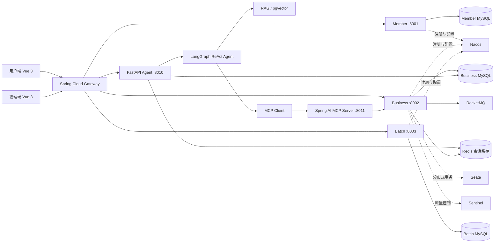

# TrainMind 智能火车票系统

TrainMind 是一个面向高并发购票与智能出行咨询场景的全栈项目。Java 侧基于 Spring Cloud 实现会员、车次、余票、异步购票和定时任务；Python 侧基于 FastAPI、LangGraph ReAct、MCP 与 RAG 实现自然语言查票、直达/中转推荐和票务规则问答；用户端和管理端均使用 Vue 3。

> 本项目用于学习、作品展示和技术验证，不连接真实铁路售票系统，请勿直接用于生产环境。

## 系统架构



购票链路与 Agent 链路相互隔离：Agent 仅开放只读查询与推荐工具，用户选定车次后跳转原购票页面，不让大模型直接执行扣库存、下单或支付。

## 技术栈

| 领域 | 技术 |
| --- | --- |
| Java 微服务 | Java 17、Spring Boot、Spring Cloud、Gateway、OpenFeign、Nacos |
| 高并发购票 | Redis、Redisson、RocketMQ、Sentinel、Seata、MyBatis、MySQL |
| Agent | Python、FastAPI、LangGraph/LangChain、ReAct、Function Calling、MCP、SSE |
| RAG | 结构化 Chunk、Embedding、pgvector、关键词/向量混合检索、RRF、Citation |
| 前端 | Vue 3、Vue Router、Vuex、Ant Design Vue、Axios |
| 批处理与测试 | Quartz、JMeter、pytest |

## 核心功能

- 会员登录、乘车人管理、车次与余票查询、选座购票和本人车票查询。
- Redis 秒杀令牌与幂等键、Sentinel 限流、RocketMQ 异步排队、Redisson 并发选座控制和 Seata 跨服务事务。
- LangGraph ReAct Agent 自主补全参数、调用车站/余票工具并推荐直达或一次中转方案。
- Spring AI MCP Server 将 Java 票务查询能力以标准只读工具提供给 Agent。
- Redis + MySQL 持久化多轮会话，浏览器刷新后可恢复历史记录。
- 基于 pgvector 的票务规则 RAG，支持混合检索、引用返回、相关度门控、无证据拒答和 Prompt Injection 检测。
- 管理端维护车站、车次、经停站、车厢、座位及每日车次，Quartz 自动生成车次数据。

## 目录结构

```text
train/
├─ common/          Java 公共模型、异常、拦截器与工具
├─ gateway/         Spring Cloud Gateway、路由与 JWT 校验
├─ member/          会员、乘车人和已购车票服务
├─ business/        车次、余票、座位与异步购票核心服务
├─ batch/           Quartz 定时任务服务
├─ generator/       MyBatis 与 CRUD 代码生成工具
├─ agent-service/   FastAPI + LangGraph Agent、记忆与 RAG
├─ agent-tools/     Spring AI MCP Server（只读票务工具）
├─ web/             Vue 3 用户端，包含智能出行助手
├─ admin/           Vue 3 管理端
├─ knowledge/       RAG 票务规则知识库
├─ sql/             MySQL 与 Seata 初始化脚本
├─ scripts/         数据初始化和维护脚本
└─ docs/            架构、设计说明与截图目录
```

## 本地启动

### 1. 环境要求

- JDK 17、Maven 3.8+
- Python 3.11+、Node.js 16+
- MySQL 8、Redis、Nacos
- RocketMQ NameServer/Broker、Seata Server
- Docker（启用 pgvector RAG 时需要）

### 2. 配置本地密钥

仓库不保存真实密码、API Key、Token 或私钥。启动 Java 服务前，在 PowerShell 中设置本机环境变量：

```powershell
$env:TRAIN_DB_USERNAME="root"
$env:TRAIN_DB_PASSWORD="<your-mysql-password>"
$env:NACOS_USERNAME="nacos"
$env:NACOS_PASSWORD="<your-nacos-password>"
$env:TRAINMIND_JWT_SECRET="<a-long-random-secret>"
```

这些变量仅对当前终端生效，请勿把真实值写回仓库。若曾经把真实密钥提交到 Git 历史，应先轮换密钥，再清理历史记录；仅加入 `.gitignore` 不能删除历史泄漏。

### 3. 初始化数据库与基础设施

创建 `member`、`business`、`batch` 数据库，然后依次导入：

```text
sql/member.sql
sql/business.sql
sql/batch.sql
sql/mysql.sql        # Seata Server 数据表
```

启动 MySQL、Redis、Nacos、RocketMQ 和 Seata，并在 Nacos 创建 `train` 命名空间。Seata 事务组需要配置：

```properties
service.vgroupMapping.train-group=default
```

### 4. 启动 Java 微服务

```powershell
mvn clean install -DskipTests
```

在 IDE 中依次启动：

1. `com.jiawa.MemberApplication`（8001）
2. `com.jiawa.BusinessApplication`（8002）
3. `com.jiawa.BatchApplication`（8003）
4. `com.jiawa.gateway.config.GatewayApplication`（8000）

### 5. 启动 MCP Server

```powershell
mvn -f agent-tools/pom.xml spring-boot:run
```

默认 MCP SSE 地址为 `http://127.0.0.1:8011/sse`。

### 6. 启动 Python Agent

```powershell
cd agent-service
python -m venv .venv
.venv\Scripts\Activate.ps1
pip install -e ".[dev]"
Copy-Item .env.example .env
```

修改本机 `agent-service/.env`，填写模型 API Key、MySQL 和 pgvector 连接信息。该文件已被 Git 忽略。

```powershell
uvicorn app.main:app --reload --port 8010
```

- Swagger：`http://127.0.0.1:8010/docs`
- 健康检查：`http://127.0.0.1:8010/health`
- 经 Gateway 调用：`POST http://127.0.0.1:8000/agent/api/v1/chat`

若启用 pgvector，先设置本地密码并启动容器：

```powershell
$env:TRAINMIND_POSTGRES_PASSWORD="<your-postgres-password>"
docker compose -f docker-compose.rag.yml up -d
```

### 7. 启动 Vue 3 前端

```powershell
cd web
npm install
npm run web-dev
```

```powershell
cd admin
npm install
npm run admin-dev
```

- 用户端：`http://localhost:9001`
- 管理端：`http://localhost:9000`
- Gateway：`http://localhost:8000`

更详细的 Agent 配置和接口示例见 [agent-service/README.md](agent-service/README.md)，MCP 工具说明见 [agent-tools/README.md](agent-tools/README.md)。

## 核心数据流

### 异步购票

```text
Gateway JWT校验 → Sentinel限流 → Redis幂等/准入令牌
→ 创建INIT确认订单 → RocketMQ异步排队 → Redisson控制并发选座
→ Seata更新座位、余票和会员车票 → 前端轮询最终状态
```

### 智能出行 Agent

```text
用户问题 → 恢复会话记忆 → LangGraph ReAct推理
→ Function Calling → MCP只读工具/票务RAG
→ 真实结果回填模型 → 行程约束校验 → SSE返回并持久化会话
```

## 测试

```powershell
# Java 编译
mvn clean compile -DskipTests

# Agent 自动化测试
cd agent-service
pytest

# 前端构建
cd web
npm run build
```

购票并发测试脚本不应包含登录 Token；建议在本地通过 JMeter 用户变量或命令行参数注入测试凭据。

## 开源参考与个人改造

Java 火车票微服务基础功能参考了 [12306project](https://gitee.com/ceo-of-handsome-group/12306project)。在此基础上，本项目主要完成了以下改造：

- 增加 Redis 幂等与秒杀准入、RocketMQ 异步受理、Redisson 并发控制及相关购票链路调整。
- 新增独立的 FastAPI + LangGraph ReAct Agent 服务、多轮会话持久化和 SSE 聊天页面。
- 新增 Spring AI MCP 工具服务，将 Java 车站和余票能力以只读工具开放。
- 新增 pgvector 混合检索 RAG、引用与安全约束，以及测试知识数据和初始化脚本。

原项目及依赖组件的版权归各自作者所有。本仓库新增代码仅用于学习和项目展示；正式发布前请进一步核对上游项目许可证并保留相应版权声明。

## 安全说明

- `.env`、虚拟环境、日志、构建产物、私钥和本机临时文件均由 `.gitignore` 排除。
- MCP Agent 仅开放只读工具，不提供下单、扣库存、取消或支付能力。
- JWT 密钥从 `TRAINMIND_JWT_SECRET` 环境变量读取，代码不再记录完整 Token。
- 数据库、Nacos、Seata 和模型凭据应通过环境变量或密钥管理服务注入。
- 当前项目仍是学习系统，未完成生产级支付、可靠消息、灾备和全链路安全审计。
